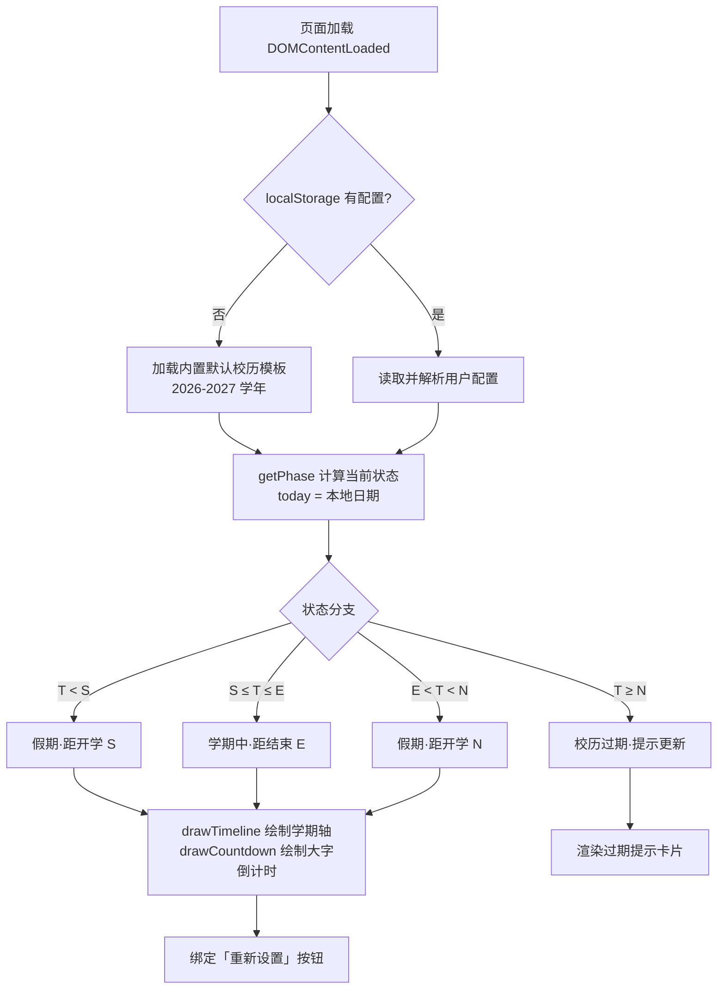
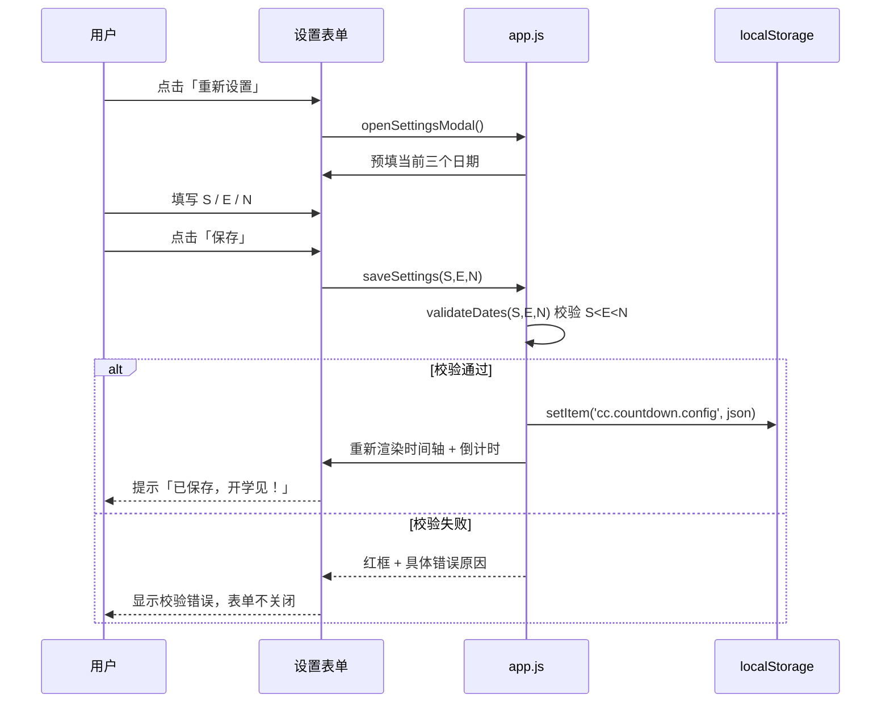

# 学期倒数 · 产品需求文档 (PRD)

> **版本**：V1.0（MVP）
> **状态**：已存档 · 待开发
> **存档日期**：2026-08-06
> **产品名**：学期倒数
> **形态**：纯静态 Web 应用（零依赖，file:// 双击可运行）

---

## 📖 目录

1. [产品路线图](#第一部分产品路线图)
2. [MVP 原型设计（选定：B 学期旅程）](#第二部分mvp-原型设计选定b-学期旅程)
3. [架构设计蓝图](#第三部分架构设计蓝图)
4. [当前状态与下一步](#第四部分当前状态与下一步)

---

# 第一部分：产品路线图

## 1.1 核心目标 (Mission)

> 让每一位大学生，打开网页的瞬间就看见「距学期结束还有几天、距假期还有几天」——把熬过期末的紧迫感和期待假期的仪式感，变成在校生活每一天的日常陪伴。

## 1.2 用户画像 (Persona)

| 维度 | 描述 |
|------|------|
| 人物 | 小林，19 岁，普通本科大二学生 |
| 场景 | 复习周刷手机、上课路上、放假前一晚——想看「还要熬几天」「还能玩几天」 |
| 痛点 | 学期节奏在心里模糊，精确天数说不清；学校 APP 查校历步骤繁琐；缺乏「熬过这段就有假期」的正反馈 |
| 行为 | 不注册就愿意打开的工具更容易上手；手机为主，电脑为辅 |

**产品定位**：先通用（服务所有高校学生）→ 后垂直（单校校历接入、课程表联动）。

## 1.3 V1 最小可行产品 (MVP)

| # | 功能 | 说明 |
|---|------|------|
| 1 | **智能倒计时看板** | 按今天日期自动切换状态：开学前→「距开学 X 天」；学期中→「距学期结束 X 天」；假期→「距下学期开学 X 天」；校历过期→提示更新 |
| 2 | **学期日期设置** | 极简表单，填三个日期：本学期开始 / 本学期结束 / 下学期开学 |
| 3 | **本地持久化** | localStorage 存设置，无需登录，刷新不丢 |
| 4 | **默认校历兜底** | 内置 2026-2027 学年模板，首次打开**即有内容**，设置后立即个性化 |
| 5 | **移动端优先响应式** | 大字倒计时 + 状态文案，手机一屏看全 |
| 6 | **随时重设入口** | 一个「重新设置」按钮，随时改日期 |

## 1.4 V2 及以后 (Future Releases)

| 版本 | 规划 |
|------|------|
| **V2.1** | 毕业倒计时（按入学年份）+ 在校总天数/进度 —— **V2 第一批优先** |
| V2.2 | 自定义倒计时（四六级 / 考研 / 考证 / 纪念日） |
| V2.3 | 多学期历史回顾与学期小结 |
| V2.4 | 分享卡片（一键生成倒计时图片/链接，社交传播） |
| V2.5 | 节日/考试事件日历 + Web 通知提醒 |
| **V3** | 账号与云同步；垂直化：单校校历一键导入、课程表联动 |

> **V2 扩展策略**：毕业倒计时与学期倒计时共享一套「时间轴/天数计算」逻辑，扩展成本最低，故定为 V2 第一批。

## 1.5 关键业务逻辑 (Business Rules)

设 `T` = 今天，`S` = 本学期开始，`E` = 本学期结束，`N` = 下学期开学。

**状态机**（核心逻辑，`getPhase(T,S,E,N)` 纯函数实现）：

```
T < S          → 假期（未开学）    显示「距开学 S 还有 D 天」
S ≤ T ≤ E      → 学期中          显示「距学期结束 E 还有 D 天」
E < T < N      → 假期（寒假）    显示「距开学 N 还有 D 天」
T ≥ N          → 校历过期        提示「新学期已开始，请更新日期」
```

**附加规则**：

1. **天数口径**：`D = 目标日期 − 今天`，不含今天。学期结束当天显示「还有 0 天」，次日自动切换为假期。
2. **数据校验**：必须满足 `S < E < N`（各至少间隔 1 天），否则表单拒绝提交并提示。
3. **兜底规则**：localStorage 为空 → 加载内置模板；用户保存 → 覆盖。
4. **无后端**：所有计算在浏览器本地完成，无任何网络请求。

## 1.6 数据契约 (Data Contract)

**本地存储**（localStorage，key：`cc.countdown.config`）：

```json
{
  "semesterStart": "2026-09-07",
  "semesterEnd": "2027-01-15",
  "nextSemesterStart": "2027-02-22",
  "updatedAt": 1785974400000
}
```

| 字段 | 类型 | 说明 |
|------|------|------|
| `semesterStart` | string `YYYY-MM-DD` | S 本学期开始 |
| `semesterEnd` | string `YYYY-MM-DD` | E 本学期结束 |
| `nextSemesterStart` | string `YYYY-MM-DD` | N 下学期开学 |
| `updatedAt` | number | 保存时间戳（毫秒），为 V2 多学期历史预留 |

**内置默认校历模板**（代码常量，兜底，2026-2027 学年）：

```json
{ "start": "2026-09-07", "end": "2027-01-15", "nextStart": "2027-02-22" }
```

**派生数据**（运行时计算，不落盘）：`phase`（状态）、`remainingDays`（剩余天数）、`todayStr`（今天日期字符串）。

---

# 第二部分：MVP 原型设计（选定：B 学期旅程）

## 2.1 设计理念

**关键词：时间轴叙事 × 位置感知。**

「学期倒数」不止是一个倒计时，而是一段**旅程**。一条横贯页面的学期轴标出开学 / 放假 / 下学期开学三个节点，「今天」标记在轴上动态移动——用户一眼就能看到自己"走到了学期的哪里"，倒计时数字则是这段旅程的注脚。自动切换（距结束 ↔ 距开学）在时间轴上天然呈现，无需解释。

**在三个候选理念中（A 极简海报 / B 学期旅程 / C 时间仪表盘）用户选定 B**：它兼具 A 的情绪感与 C 的信息完整度，且"位置感知"的设计为 V2 毕业倒计时、自定义倒计时预留了天然扩展位。

## 2.2 概念原型图（ASCII）

```
┌────────────────────────────────┐
│  学期倒数 · 校历旅程            │
│                                │
│  ┌──────────────────────────┐  │
│  │ ●─────────────●───○      │  │
│  │ 9.07         今天 1.15     │  │
│  └──────────────────────────┘  │
│                                │
│        ▸ 学期中 · 第10周        │
│                                │
│        距本学期结束             │
│          3 7 2 天              │
│                                │
│  ┌──────┬──────┬────────────┐  │
│  │开学日 │放假日 │ 下学期开学 │  │
│  │ 9.07  │ 1.15 │  2.22      │  │
│  └──────┴──────┴────────────┘  │
│                       [ 重设 ]  │
└────────────────────────────────┘
```

## 2.3 设计说明

**布局层级（自上而下，一屏）**：

1. **品牌栏**：左上「学期倒数 · 校历旅程」小字，克制。
2. **学期轴（Hero）**：横贯的进度条 = 今天在 [S, E] 中的位置。轴上三个标记：
   - `●` 开学日（S）——实心圆
   - `○` 放假日（E）与下学期开学（N）——空心圆
   - `▽` 今天——倒三角，随日期动态移动（视觉焦点）
   - 轴下方标注各节点日期
3. **状态行**：`▸ 学期中 · 第10周`，显示当前所处状态与周数。
4. **大字倒计时**：主视觉，如「距本学期结束 **372 天**」，数字占主导。
5. **日期节点卡**：三个小卡片（开学日 / 放假日 / 下学期开学），一眼速览全学期时间表。
6. **重设入口**：右下角弱化按钮「重设」，点开设置表单。

**交互规则**：

- 「重设」→ 弹出设置表单（预填当前三日期）→ 填写 → 「保存」→ 校验 → 写 localStorage → 页面即时重渲染。
- 校验失败：目标字段红框 + 具体原因，表单不关闭。
- 校历过期（T ≥ N）：主视图切换为过期提示卡「新学期已开始，请更新日期」，引导重设。

**视觉规范（建议，开发时细化）**：

| 元素 | 规范 |
|------|------|
| 主色 | 语义色随状态呼吸：学期中暖橙（#F59E0B）/ 假期冷青（#0EA5E9）/ 过期灰红 |
| 背景 | 浅色渐变，留白充足，突出时间轴 |
| 字体 | 数字用大字号（clamp 响应式），衬线/无衬线选择以克制为准 |
| 动效 | 「今天」标记滑动、数字变化轻微过渡（纯 CSS transition，无重依赖） |
| 响应式 | 375px 优先设计；桌面端居中，最大宽度 ~480px 保持卡片感 |

---

# 第三部分：架构设计蓝图

## 3.1 项目文件结构

```
C:\Users\18310\Desktop\产品1\
├── index.html     # 单页应用入口，语义化结构 + 设置表单
├── styles.css     # 全部样式（纯 CSS，移动优先）
├── app.js         # 应用逻辑（普通 script，非 ES Module）
└── Prd.md         # 产品需求文档（本文件）
```

> 全新项目，无既有模块需要兼容。

## 3.2 核心流程图

### 流程图 1 —— 应用初始化



### 流程图 2 —— 用户设置学期日期



## 3.3 组件交互说明

`app.js` 内部按职责分为 4 个逻辑层（普通函数组织，非 ES Module——避免 `file://` 双击时 CORS 拦截）：

| 逻辑层 | 职责 | 关键函数 |
|--------|------|---------|
| **Config** | localStorage 读写 + 默认模板 + JSON 容错 | `loadConfig()` / `saveConfig(cfg)` / `DEFAULT_CALENDAR` |
| **DateUtils** | 日期解析与状态计算（**纯函数**，可复用） | `parseDate('YYYY-MM-DD')` / `getPhase(T,S,E,N)` / `daysUntil(target)` |
| **UI** | 渲染与交互 | `render()` / `drawTimeline()` / `drawCountdown()` / `openSettings()` / `saveSettings()` |
| **Main** | 初始化入口 | `init()`（DOMContentLoaded 触发） |

**调用关系**：

```
index.html (DOM + 表单)
   └─ <script src="app.js">
        └─ init()
             ├─ Config.loadConfig()      → 用户配置 或 默认模板
             ├─ DateUtils.getPhase()    → phase + remainingDays
             ├─ UI.drawTimeline()       → 学期轴（CSS 进度 = 今天在[S,E]位置）
             ├─ UI.drawCountdown()      → 大字倒计时 + 状态文案
             └─ 绑定重设按钮 → UI.openSettings() → UI.saveSettings()
```

## 3.4 技术选型与风险

| 选型 | 理由 | 风险与对策 |
|------|------|-----------|
| 原生 JS，零依赖零构建 | 双击 file:// 即可运行，可托管任意静态服务，最快上线 | 后续规模化（V2 分享卡片/账号）需迁移；**预留纯函数边界**（DateUtils 与 Config 解耦）降低迁移成本 |
| 本地时区日期构造 `new Date(y, m-1, d)` | 避免 ISO 字符串 UTC 偏移导致「少一天」 | **关键风险**：必须统一本地时区构造，**禁用 `new Date('YYYY-MM-DD')`** 解析日期 |
| `<script>` 普通标签（非 module） | `file://` 下 ES Module 被浏览器 CORS 拦截 | 若未来引入构建工具再切换 module |
| 时间轴纯 CSS 渲染 | 进度条 = 今天在 [S,E] 中的百分比，无 canvas 依赖 | 跨年边界注意日期计算 |
| localStorage | 三日期数据量极小，容量无忧 | `JSON.parse` 需 try/catch，损坏时回退默认模板 |
| 响应式 | 移动端优先（主力用户是手机） | 375px 断点优先设计，桌面端居中放大 |

**技术风险清单**：

1. **日期偏移（高）**：`new Date('2026-09-07')` 会被解析为 UTC 零点，在中国时区（UTC+8）显示为本地当天 08:00，跨天边界比较会差一天 → 统一用 `new Date(y, m-1, d)` 本地构造。
2. **file:// CORS（中）**：ES Module 在 file:// 下被拦截 → 刻意使用普通 `<script>`。
3. **localStorage 损坏（中）**：手动篡改或旧版数据导致 `JSON.parse` 抛错 → try/catch 后回退默认模板。
4. **设备日期不准（低）**：极小概率，忽略并在代码注释中标注。

## 3.5 V2 扩展点

- `getPhase` / `daysUntil` 保持**纯函数**，V2.1 毕业倒计时、V2.2 自定义倒计时直接复用「目标日期 → 剩余天数」计算。
- `Config` 层保留 `updatedAt` 时间戳，为 V2.3 多学期历史提供排序依据。
- 「时间轴」抽象为 `[S, E]` 区间渲染，天然承载"学期旅程"外的自定义事件轴。

---

# 第四部分：当前状态与下一步

## 4.1 当前状态

| 阶段 | 状态 |
|------|------|
| 启发式对话与决策 | ✅ 已完成 |
| 产品路线图 | ✅ 已锁定 |
| MVP 原型选定（B 学期旅程） | ✅ 已锁定 |
| 架构设计蓝图 | ✅ 已完成 |
| PRD 存档（本文件） | ✅ 已完成 |
| MVP 开发（index.html / styles.css / app.js） | ⏳ 待开发 |

## 4.2 下一步建议

1. 按原型 B「学期旅程」实现 V1 六个功能（文件结构见 §3.1）。
2. 完成后在浏览器双击 `index.html` 验证：默认校历兜底 → 设置 → 重渲染闭环。
3. 上线可托管至 GitHub Pages / Vercel / Netlify（纯静态零成本）。
4. V2.1 毕业倒计时迭代。

---

> 本 PRD 为「学期倒数」产品的唯一权威需求文档。后续任何需求变更需在此文档更新并更新版本号。
